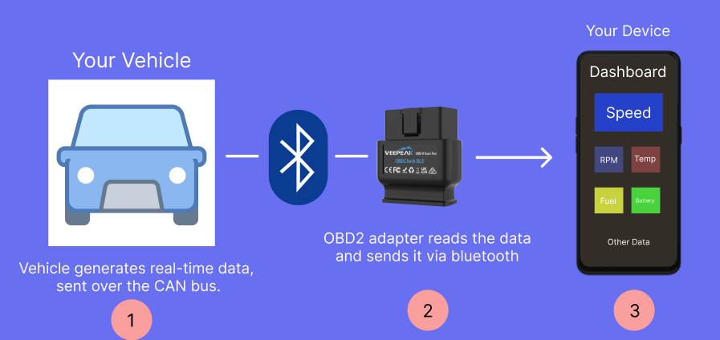
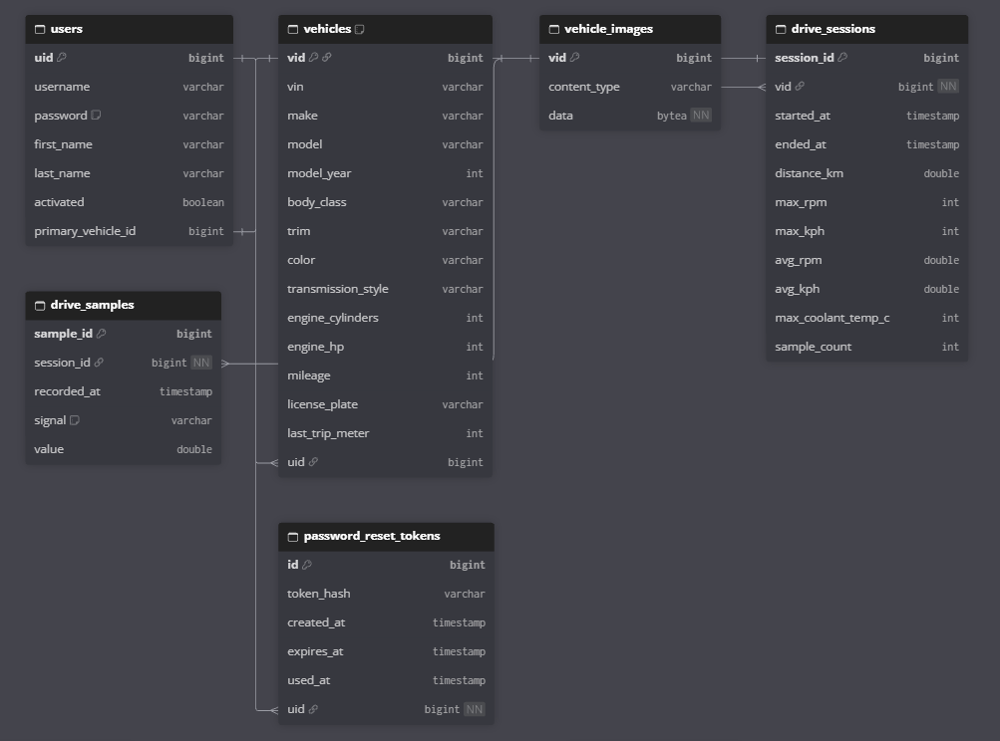

# CarTracker

A web app that reads live data from your car over Bluetooth and saves your drives.

Plug an OBD-II Bluetooth adapter into your car, open CarTracker in Chrome, and you get live gauges for speed, RPM, coolant temperature, steering angle and each wheel's speed. Every drive is recorded, so you can look back at charts, mileage and your vehicle's top stats.

https://github.com/user-attachments/assets/8f75da4b-da06-4949-9fa5-9b3351d03122

---

## How it works



1. An **ELM327 OBD-II Bluetooth adapter** plugs into the car's diagnostic port.
2. The **phone or laptop** connects to the adapter through the browser's Web Bluetooth API and reads the car's CAN bus.
3. The **Angular frontend** decodes the signals into live gauges and sends samples to the backend every few seconds.
4. The **Spring Boot backend** stores users, vehicles, drive sessions and samples in **PostgreSQL**.

## Features

- **Live vehicle data**: speed, RPM, coolant temp, steering angle, wheel speeds, fuel level and battery voltage
- **Drive recording**: each drive is saved as a session with all of its samples
- **Charts and stats**: graphs of past drives, trip-based mileage and max-stat records
- **Garage**: add vehicles by VIN (decoded automatically with the NHTSA vPIC API), edit them, upload a photo and pick a primary car
- **Accounts**: register, log in, change your password and reset a forgotten password by email

## Tech stack

| Part      | Tech                                                        |
| --------- | ----------------------------------------------------------- |
| Frontend  | Angular 21, Angular Material, Highcharts, Web Bluetooth     |
| Backend   | Java 21, Spring Boot 4, Spring Security, JPA, MapStruct     |
| Database  | PostgreSQL (runs in Docker)                                 |
| Hardware  | ELM327 OBD-II BLE adapter (Vgate)                           |

## Database



---

## Getting started

### What you need

- [Java 21](https://adoptium.net/)
- [Node.js](https://nodejs.org/) (LTS)
- [Docker Desktop](https://www.docker.com/products/docker-desktop/) (it runs the database)
- **Chrome or Edge** (Web Bluetooth doesn't work in Safari or Firefox, so iPhone browsers are out)

### 1. Start the backend

```bash
cd backend
./mvnw spring-boot:run        # Windows: mvnw.cmd spring-boot:run
```

Spring Boot starts the PostgreSQL container from `compose.yaml` on its own, so make sure Docker is running first. The API runs at `http://localhost:8080`.

### 2. Start the frontend

```bash
cd frontend
npm install
npm start
```

Open **http://localhost:4200**. API calls are proxied to the backend automatically.

### 3. Connect to your car

1. Plug the OBD-II adapter into the port under your dashboard and turn the car on.
2. Register, log in and add your vehicle.
3. On the dashboard, press **Connect** and choose the adapter from the Bluetooth popup.
4. Drive, and the gauges will update live.

### Optional: password reset emails

Reset emails are sent to a local SMTP server on port `1025`. To see them, run a mail catcher such as [Mailpit](https://mailpit.axllent.org/):

```bash
docker run -p 1025:1025 -p 8025:8025 axllent/mailpit
```

Then open `http://localhost:8025` to read them.

---

## Good to know

- **Vehicle support:** the CAN signal IDs in [`can-signals.ts`](frontend/src/app/features/obd/can-signals.ts) are mapped for a **2012 Honda Accord**. Other cars use different IDs, so you'd need to update that file.
- **Adapter:** built and tested with a Vgate ELM327 BLE adapter. Other BLE adapters may use different service and characteristic UUIDs (set in [`obd-connection.ts`](frontend/src/app/features/obd/obd-connection.ts)).

## Project structure

```
cartracker/
├── backend/            Spring Boot API
│   └── src/main/java/com/maxshkrabak/cartracker/
│       ├── controller/ REST endpoints (auth, vehicle, drive)
│       ├── service/    business logic
│       ├── model/      entities and DTOs
│       └── repository/ database access
├── frontend/           Angular app
│   └── src/app/features/
│       ├── auth/       login, register, password reset
│       ├── dashboard/  main page
│       ├── obd/        Bluetooth connection and CAN decoding
│       └── vehicles/   garage, charts and stats
└── docs/               README images
```
